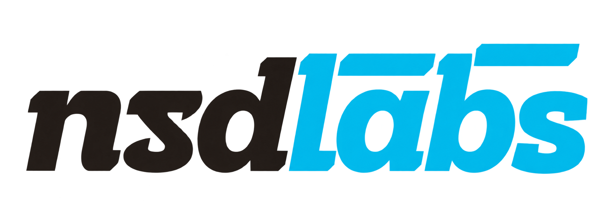

<div align="center">
    
    <h2>Kayan Attendance</h2>
    <p align="center">
        <b>Attendance Watchdog for Frappe HR: No Check-in Left Open</b>
    </p>

[](https://github.com/frappe/frappe)
[](https://github.com/frappe/erpnext)
[](https://github.com/frappe/hrms)
[](license.txt)

</div>

## Kayan Attendance

Kayan Attendance is a Frappe app that watches attendance in Frappe HR (hrms). Every
10 minutes it looks for employees who checked in but never checked out. When their
check-out time passes, which is 17:00 by default, it writes the check-out for them.
Employees who need to stay later can get a **Check-in Time Extension**. The app works
with the **Frappe HR mobile app** (`/hrms`) in both directions.

It runs on ERPNext v16.51 and later, with Frappe HR v16.

## Philosophy

> An open check-in is a lie the attendance sheet tells every night.

The Frappe HR mobile app picks its button from the employee's **latest** check-in log.
If someone forgets to check out, the app keeps offering "Check Out" the next morning.
HRMS auto attendance also has no pair to work with, so the day ends up as an absence
or a half day.

Kayan Attendance closes each open check-in at the right time. It uses only standard
Frappe HR documents, so attendance, the mobile app and reports pick the result up
with no changes to `frappe`, `erpnext` or `hrms`.

## Key Features

- **Attendance watchdog**: a scheduled job that runs every 10 minutes and finds open
  check-ins from the last few days (the number of days is a setting).
- **Automatic check-out at 17:00**: writes a standard `OUT` Employee Checkin. The time
  can be a fixed time or the end of the employee's shift.
- **Check-in Time Extension**: a submittable request that moves one employee's
  automatic check-out later on one day. It is approved by the same people who
  approve HRMS Shift Requests, and it can't go past a maximum number of hours.
- **Works with the Frappe HR mobile app in both directions**:
  - *What the app sees:* the automatic check-out shows up live in the app (*Kayan
    Auto Checkout* in the check-in history), and the button changes back to
    **Check In**. The employee also gets an app notification, sent as a push
    notification when push is enabled.
  - *What the app does:* if an employee checks in again from the app after being
    checked out automatically, they are still working. Kayan Attendance raises an
    extension request for them, which can be approved automatically. Approved Shift
    Requests made from the app change the shift end, and the watchdog follows it.
- **Safe with geofencing**: the check-out reuses the coordinates of the check-in,
  so it passes HRMS check-in radius rules.
- **Audit trail**: every automatic check-out is recorded in an **Attendance Watchdog
  Log** (one row per check-in, with any error and the number of attempts). It is
  also marked on the Employee Checkin itself with *Automatic Check-out*, *Check-out
  Rule* and *Closes Check-in*.
- **Open Check-ins report**: lists who is checked in right now, when the watchdog
  will close each check-in and why, with a *Run Watchdog Now* button.
- **Frappe v16 desk**: an app tile, two sidebars (*Kayan Attendance* and *Kayan
  Attendance Setup*), dock icons and a workspace with number cards.

## How the check-out time is chosen

For each open check-in:

| Rule | Check-out time |
|---|---|
| **Fixed Time** | The day of the check-in at *Automatic Check-out Time* (17:00) |
| **Shift End** | The shift end Frappe HR recorded on the check-in, when *Check-out Time Based On* is *Shift End* |
| **Extension** | An approved Check-in Time Extension for that employee and day, if it is later |
| **Late Session** | For a check-in made after all of the above: the check-in time plus *Late Session Hours*, and never past midnight |

The watchdog never writes a check-out after the employee's next check-in. It closes
the check-in once the time plus *Grace Minutes* has passed. Employees with *Skip
Automatic Check-out* ticked are left alone.

## Production Setup

### Self Hosting

Prerequisites: a bench with Frappe, ERPNext and Frappe HR v16, on Python 3.10+ and
Node 20+.

```bash
bench get-app https://github.com/OneSpaceerp/kayan_attendance
bench --site <site> install-app kayan_attendance
bench --site <site> migrate
bench build --app kayan_attendance
bench restart
```

The scheduler must be on for the watchdog to run:

```bash
bench --site <site> enable-scheduler
```

Installing adds the custom fields on **Employee** and **Employee Checkin** and fills
in the default settings. Both steps are safe to repeat, and both run again on every
`migrate`.

### Configure

Open **Kayan Attendance Setup → Kayan Attendance Settings**:

1. **Attendance Watchdog**: turn it on, set *Automatic Check-out Time* (17:00), and
   choose *Fixed Time* or *Shift End*. Optionally set *Grace Minutes*, *Look Back
   Days* and *Late Session Hours*.
2. **Check-in Time Extension**: set the default and maximum hours, and choose
   whether checking in again from the mobile app should raise a request and
   whether that request is approved automatically.
3. **Notifications**: choose whether to notify employees in the Frappe HR app and
   whether to notify approvers of new requests.

Extension approvers come from the employee's **Shift Request Approver**, then the
department's shift request approvers, then the employee's *Reports To* manager.
HR Manager and HR User can always approve.

### API for other mobile clients

| Method | Purpose |
|---|---|
| `kayan_attendance.api.get_checkout_status` | The open check-in of the logged-in employee and when it will be closed |
| `kayan_attendance.api.request_extension` (POST) | Ask for a later check-out: `extended_until`, `reason`, optional `date` |
| `kayan_attendance.api.run_watchdog_now` (POST) | Run the watchdog straight away (HR Manager, HR User, System Manager) |

## Development Setup

### Local

1. Set up a bench with Frappe, ERPNext and Frappe HR v16 and create a site, then:

    ```bash
    cd frappe-bench
    bench get-app /path/to/kayan_attendance
    bench --site kayan.localhost install-app kayan_attendance
    bench --site kayan.localhost set-config developer_mode 1
    bench start
    ```

2. Open `http://kayan.localhost:8000/desk/kayan-attendance`.

### Tests

```bash
bench --site kayan.localhost set-config allow_tests true
bench --site kayan.localhost run-tests --app kayan_attendance
```

### App Structure

```
kayan_attendance/
├── hooks.py                      scheduler (every 10 min), Employee Checkin event, desk icons
├── attendance_watchdog.py        open check-in detection, check-out rules, auto check-out
├── events/employee_checkin.py    re-check-in from the mobile app → extension request
├── api.py                        whitelisted endpoints
├── constants/custom_fields.py    fields on Employee and Employee Checkin
├── kayan_attendance/             module: doctypes, report, number cards, workspace, sidebars
├── workspace_sidebar/            v16 workspace sidebars
├── desktop_icon/                 v16 desktop icons
├── dock/                         v16 dock
└── public/icons/module-icons.svg duotone and soft module icons
```

## Learning and Community

1. [Frappe HR documentation](https://docs.frappe.io/hr): shifts, check-ins and auto attendance
2. [Frappe Framework documentation](https://docs.frappe.io/framework): building Frappe apps
3. [Frappe Forum](https://discuss.frappe.io): the community of Frappe users and service providers

## Contributing

1. Report issues and ideas to [info@nsd-eg.com](mailto:info@nsd-eg.com)
2. Report security vulnerabilities privately to the same address
3. Pull requests should pass `ruff` and the app's tests

## License

GNU General Public License v3. See [license.txt](license.txt).

<br>
<br>
<div align="center">
    <a href="https://nsd-eg.com" target="_blank">
        
    </a>
    <p><sub>Published by <b>nsdLabs</b> · Nest Software Development · <a href="mailto:info@nsd-eg.com">info@nsd-eg.com</a></sub></p>
</div>
